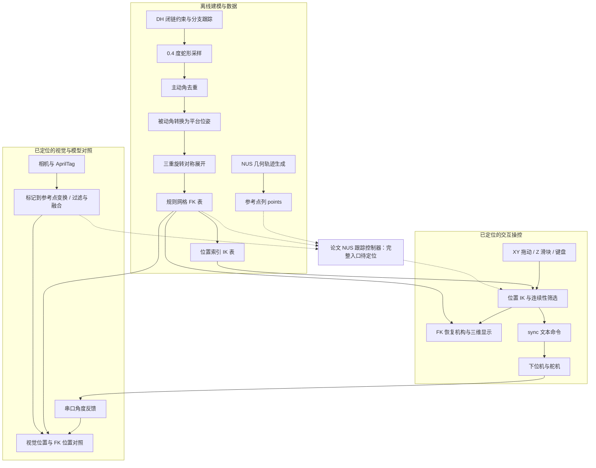

# RoboSoft2026: A Compact Foldable Modular Design with Large Deformation and Force Application

[English overview](#english-overview) | [中文说明](#中文说明)

> Canfield-inspired foldable module · 3-RSR kinematics · Offline lookup tables · AprilTag vision · Interactive control
>
> 以两个实验 Demo 为入口，串起机构建模、离线构表、在线 FK/IK、视觉测量与串口执行。

## English overview

This project studies a compact, inward-folding modular robot inspired by the Canfield joint. The accompanying paper, **A Compact Foldable Modular Design with Large Deformation and Force Application**, is authored by Wenbo Li, Yuli Song, Wenci Xin, and Cecilia Laschi.

Two demonstrations organize the codebase: **N–U–S trajectory drawing**, described in the paper as visual closed-loop tracking, and **dual-module obstacle removal and object relocation**, confirmed by the project author as open-loop execution of previously recorded targets. The available source contains kinematic solvers, lookup-table generation, trajectory generators, AprilTag processing, interactive visualization, serial communication, and result plotting. The complete NUS feedback controller and the dual-module target-sequence executor have not been located in this snapshot.

The closest matches to the remembered interactive control interface are `scripts/control/canfield_live_ik_demo.py` (visualization) and `scripts/control/cover_control.py` (visualization plus serial commands). Large lookup tables were deliberately omitted from GitHub; the original data are on another computer, and the generation logic is documented below.

This README follows the IROS repository's organization—demonstrations, overview, platform, architecture, methods, results, modules, usage, and data workflow—while describing RoboSoft's actual Python and serial interfaces. Detailed code navigation is provided in Chinese.

## 中文说明

本文以本地 `robosoft26.pdf`、当前解压源码和项目作者的补充说明为依据，重点回答：**两个 Demo 各自在做什么、核心代码在哪里、模块之间传递什么，以及如何从运动学模型生成用于控制的查表数据。** 本次只整理文档，没有修改控制程序，也没有重新执行实机实验。

### 1. 演示与阅读入口

| Demo | 内容与控制方式 | 首先阅读的代码 | 素材 |
|---|---|---|---|
| Demo 1：NUS 绘制 | 单模块在不同高度跟踪 N、U、S 轨迹；论文描述为 AprilTag 视觉反馈下的闭环跟踪 | `nusrobo_trajectory.py` → `control_demo_base_.py` → FK/IK → `error_finder.py` / `repaint_new.py` | [NUS.mp4](../../NUS.mp4)，论文 §IV-A、Fig. 6 |
| Demo 2：推障、拾取与释放 | 两模块配合执行预先记录的目标；作者确认任务层为开环控制 | 先看 `canfield_live_ik_demo.py` 与 `cover_control.py` 理解可视化操控，再看 `serial_commander.py` | [CLLECT AND RELEASE.mp4](../../CLLECT%20AND%20RELEASE.mp4)，论文 §IV-B、Fig. 7 |

**代码索引：** [NUS 轨迹生成](scripts/control/nusrobo_trajectory.py) · [可视化 IK/FK](scripts/control/canfield_live_ik_demo.py) · [可视化实机操控](scripts/control/cover_control.py) · [视觉与模型对照](scripts/control/control_demo_base_.py) · [串口接口](scripts/control/serial_commander.py) · [论文](../../robosoft26.pdf)。

两个 Demo 都可从单模块运动学与执行接口理解，但是否复用同一任务程序尚未确认。NUS 需要根据实际末端位置持续修正轨迹误差；推障取放按已记录目标执行动作序列。这里的“开环”描述任务空间是否使用视觉误差修正，并不否认舵机内部可能有位置控制。

当前最明确的可视化操控程序是 `cover_control.py`：三维机构显示 + XY 拖动面板 + Z 滑块 + 方向键操作 + IK + 串口下发。它本身每次发送一组三个舵机角度；代码中未发现双模块目标列表、目标录制按钮或完整序列回放逻辑。因此可以把它定位为通用交互操控工具，但不能直接认定它就是第二个 Demo 的完整执行程序。

### 2. 项目概述与机器人平台

项目面向狭窄空间内的展开、变形和施力任务。机构采用向内折叠的连杆布置，在减少外部空间占用的同时保留伸缩与弯曲能力；单模块由三条支链和三个底部舵机驱动，运动学上简化为 3-RSR 并联机构。两模块串联用于推开障碍、调整抓取姿态并搬运物体。

论文的主要贡献包括向内折叠的模块设计、几何参数对工作空间的分析、力学特性测量，以及两个应用 Demo。代码侧与 Demo 最直接相关的工作则是：**把计算较重的闭链运动学放到离线构表阶段，用快速查询支持交互操控，并结合视觉测量与轨迹数据完成实验。**

| 论文中的平台信息 | 数值或描述 | 出处 |
|---|---|---|
| 外廓直径 | 140 mm | §II-A |
| 折叠／展开长度 | 28 mm / 145 mm，展开长度超过折叠长度的 5 倍 | §II-A、Fig. 1 |
| 最大弯曲角 | 60° | §II-A |
| 驱动角限制 | 论文机构设计限制为 70° | §II-A |
| 单模块执行器 | 3 个底部嵌入式舵机 | §II-A |
| 双模块演示 | 两个模块串联，末端使用气动软夹爪 | §IV-B、Fig. 7 |

这些是论文平台指标。代码中的 DH 几何参数、舵机零点与视觉工具偏置属于另一层定义，不能仅凭名称与论文尺寸一一等同。

### 3. 系统架构

当前工程由 Python 脚本组成，通过 CSV/NPZ 文件传递离线数据，通过串口连接下位机。没有 IROS 项目中的 ROS2 节点、消息接口或神经网络训练流程。



实线表示能够从当前源码直接追踪的模块关系；虚线表示论文中的 NUS 闭环连接。`control_demo_base_.py` 已包含视觉和模型位置对照，但没有把误差送入 PID 并下发修正命令。

#### Demo 1：NUS 绘制的数据流

```text
N/U/S 几何生成器 → 参考轨迹 points
相机 → AprilTag → 工具参考点的实测位置
参考轨迹 + 实测位置 → 局部投影 / 前视目标 → 自适应 PID  [论文描述]
模型名义位置 + 修正量 → IK → 舵机命令                  [论文描述]
实验记录 → 几何轨迹误差统计 / 三维叠图 / 动画
```

已定位的轨迹生成器和结果分析脚本与这条流程对应；完整跟踪循环尚未在当前快照中找到。`src/kinematics/ik_npz_verify.py` 末尾有包含视觉值、PID 输出和 `sync` 命令的历史调试注释，可作为寻找原控制程序的线索，不能当作可执行控制器。

#### Demo 2：开环动作与可视化操控

作者确认第二个 Demo 使用预先记录的目标。现有 `cover_control.py` 能说明通用交互控制如何工作：

```text
目标平台中心 Bo(mm)
  → IK.solve(Bo, q_curr=prev_q)
  → 检查 warnings 与位置误差阈值
  → q_model − 90°
  → sync a b c → 串口执行
  → 同时以 FK 更新三维机构显示
```

`prev_q` 是上一轮求解的目标角，用于保持解的连续性，并非当前实测关节角。目标列表保存的是末端位置还是舵机角、双模块如何分配命令、夹爪如何触发，均需从原实验程序或记录中确认；当前快照不能回答这些细节。

### 4. 核心方法：模型、查表与控制

#### 4.1 闭链运动学与分支选择

[canfield_homotopy.py](src/kinematics/canfield_homotopy.py) 是离线查表主线的运动学核心。`CanfieldOps` 根据三条支链的 DH 变换建立几何约束：每条支链有一个主动角，内部使用两个独立被动角，并令 `q4 = -q2`。三个主动角给定后，用 `scipy.optimize.least_squares(method='trf')` 求解六个独立被动变量。

残差包含三类共九项约束：上平台三边长度、三条末端轴与平台法向的垂直关系、末端轴与平台径向的角度关系。采样时使用前一个位置的解作为下一位置的初值，并结合 `cluster_ok_fast()` 的被动角符号条件筛选构型；这用于处理并联机构多解和采样分支连续性问题。

源码中的支链可概括为：

```text
T0 · A1(q1) · A2d(q2, L1+L2) · A2a(L3) · A3(q3, L3) · A4(q4, L1+L2)
```

**论文与实现的对应边界：** 论文 §II-B 用平台位置、Rodrigues 姿态、Newton 迭代和比例镜像初值阐述通用模型；当前查表主线使用 DH 支链、被动角最小二乘与连续初值。两者都处理机构几何闭合，但参数化和数值实现不同。论文中不等杆长／偏转角的完整参数扫描程序尚未定位，不能把当前 DH 源码写成论文公式的逐行实现。

#### 4.2 离线构表为什么能加速在线控制

离线阶段对主动角空间做密集求解，提前保存每组角度对应的被动角、平台中心和姿态。在线阶段读取这些结果并插值，避免每次交互或控制更新都重新求解完整闭链约束。

主构表入口设定 `step=0.4°`、主动角范围 `90–160°`，先遍历 `q1 ≥ q2` 且 `q1 ≥ q3` 的区域，再利用三条支链的旋转对称性展开到全域。循环置换主动／被动角时，也对平台位置和姿态施加对应的 `0°、+120°、−120°` 旋转。

#### 4.3 在线 FK 与 IK

| 查询 | 输入 | 核心实现 | 输出 |
|---|---|---|---|
| FK | 三个模型主动角，单位 deg | 规则角度网格中的相邻八点插值 | 平台中心 mm、姿态，部分实现还返回被动角与连杆点 |
| IK | 目标平台中心 mm，可选上一组主动角 | 位置 `cKDTree` 检索 → 角度连续性门控 → IDW 插值 | 三个主动角 deg、误差／警告信息 |

以 [ik_npz_verify.py](src/kinematics/ik_npz_verify.py) 为例，IK 先取 36 个空间近邻，根据候选角与当前角的最大分量差筛选，角度门限从 1.2° 逐步放宽至 8°，最后最多用两个近邻按 `1/(distance+eps)^2` 加权。这些数值属于该脚本的默认设置，其他演示内嵌实现应以各自参数为准。

这里主要是**位置 IK**：目标是三维位置，平台姿态由机构构型随之确定，不是对任意六维位姿独立求逆解。FK 部分实现对 `zyx` 欧拉角直接插值，再转成四元数；不能将其描述为四元数 SLERP。早期 `canfield_lkt_k.py` / `canfield_lkt_ik.py` 则使用 CSV 与 KDTree/IDW，属于另一种查询实现。

#### 4.4 NUS 的论文控制律

论文 §IV-A 先在参考路径上寻找局部投影和前视目标，前视距离为 11 mm。设视觉末端为 `p_vis`、前视目标为 `p_tgt`、路径投影为 `p_proj`、单位切向为 `t_hat`：

```text
e_raw = p_tgt − p_vis
e_n   = (p_proj − p_vis) − dot(p_proj − p_vis, t_hat) · t_hat
e_mix = Kt · e_raw + Kn · e_n
u     = Kp(||e_mix||) · e_mix + Ki · integral(e_mix) + Kd · derivative(e_mix)
```

`e_raw` 推动末端向前视目标运动，`e_n` 修正偏离路径的法向误差；论文中 `Kt、Kn` 自适应调整，`Kp` 在 `[0.12, 0.20]` 内变化，积分和微分项设有约束与死区。修正量叠加到 FK 给出的名义位置，再经 IK 转为舵机角。此处用于解释 Demo 方法，完整可执行入口仍待定位。

### 5. 实验结果与代码对应

下表均为**论文报告结果**，不是本次读取代码重新测得的结果。

| 实验 | 论文结果 | 对应源码或素材 |
|---|---|---|
| 偏转角与工作空间 | δ 为 0°、30°、60°、90° 时体积分别为 169.65、178.88、207.69、265.09 cm³ | §III-A、Fig. 3、Table I；完整扫描入口未定位 |
| 杆长比例分析 | 在论文比较的构型中，`L1/(L1+L2)=0.3` 获得较大的平面覆盖 | §III-B、Fig. 4；不要用 DH 参数直接替代该比值 |
| 力输出特性 | 约 25° 附近由几何锁止状态转为弹性展开状态；锁止区域约 8–10 N | §III-C、Fig. 5 |
| NUS 空间轨迹 | 三层高度 220、200、180 mm；平均误差 1.915 mm，峰值低于 5.3 mm | §IV-A、Fig. 6；`nusrobo_trajectory.py`、`error_finder.py`、`repaint_new.py` |
| 控制时序 | 查询延迟低于 1 ms；端到端延迟约 80 ms；论文称闭环频率 180–200 Hz | §IV-A；三种时序指标含义不同，不能互相替代 |
| 双模块任务 | 推开 2.5 kg 障碍，完成拾取、搬运与放置 | §IV-B、Fig. 7；第二段 Demo，负载绘图见 `repaint_load.py` |

工作空间增幅在摘要中概述为 55%，正文按 Table I 给出约 56.3%；引用时应明确取自哪个位置。第二个 Demo 的 2.5 kg 是**被推开的障碍质量**，不应写成末端举升载荷。

`error_finder.py` 采用“每个实测点到参考轨迹点集的最近邻距离”统计均值和最大值，属于几何路径误差；它不是将两个时间序列按相同索引相减。当前快照中的实验绘图脚本以原始日志为输入，图示本身不构成控制入口。

### 6. 项目结构

以下是当前代码根目录的功能树；未逐一列出所有试验版本。

```text
RoboSoft2026-main/
├── README.md
├── scripts/
│   └── control/
│       ├── nusrobo_trajectory.py       # N/U/S 参考轨迹生成
│       ├── canfield_live_ik_demo.py    # 交互式 IK/FK 可视化
│       ├── cover_control.py           # 同类界面 + 实机串口下发
│       ├── control_demo_base_.py      # AprilTag 与 FK 位置对照
│       ├── serial_commander.py        # 串口文本命令 / 二进制角度反馈
│       ├── error_finder.py            # 最近路径误差统计
│       ├── repaint*.py                # 轨迹和舵机负载重绘
│       └── ani_repaint.py             # 轨迹动画输出
├── src/
│   ├── kinematics/
│   │   ├── canfield_homotopy.py       # 闭链求解、分支延续、蛇形采样
│   │   ├── deduplication.py          # 构表结果去重
│   │   ├── build_ik_npz.py           # 规则 FK 表 → 位置索引 IK 表
│   │   ├── ik_npz_verify.py          # 在线 FK/IK 查询参考
│   │   ├── canfield_joint_symplified.py
│   │   └── canfield_joint_inverse_symplified.py  # 理想镜像模型原型
│   ├── data/
│   │   ├── full_lookup_1.py          # 被动角 → 中心与姿态
│   │   ├── full_lookup_2.py          # 旋转对称展开
│   │   └── load_npz_from_pandas.py   # CSV → 规则网格 NPZ
│   ├── vision/
│   │   ├── calib.py                 # 相机内参与畸变标定
│   │   ├── apriltag_cal_T_to_center.py  # 标记到工具参考点标定
│   │   ├── test_apriltag_*.py        # 检测、融合、零位实验
│   │   ├── marker_to_center.npz
│   │   └── center_zero_pose.npz
│   ├── visualization/
│   │   ├── canfield_plot.py          # DH 构型显示
│   │   ├── canfield_plot_ani.py      # 构型路径动画
│   │   └── *.npz                    # GitHub 中的查表占位文件
│   └── canfiled_ik_play.py           # 早期查表交互版本，文件名保留原拼写
├── tests/                            # 手动诊断与可视化脚本
├── apriltag_markers/                  # tag36h11 图片与打印 PDF
└── aruco_markers/                     # ArUco 标记与测试图片
```

### 7. 核心模块详述

#### 7.1 轨迹生成与可视化操控

| 文件 | 输入／交互 | 输出／用途 |
|---|---|---|
| [nusrobo_trajectory.py](scripts/control/nusrobo_trajectory.py) | 字母尺寸、圆弧／倒角参数、采样间隔与中心位置 | 三个 `spline_trajectory*.npz`，键 `points`，并显示三维参考轨迹 |
| [canfield_live_ik_demo.py](scripts/control/canfield_live_ik_demo.py) | XY 拖动、方向键、`Z/X` 高度操作、Z 滑块 | IK 求角 → FK 绘制机构；没有实际串口发送 |
| [cover_control.py](scripts/control/cover_control.py) | 同类可视化界面 | 在合法 IK 解下发送 `sync`；交互式开环操控 |
| [control_demo_base_.py](scripts/control/control_demo_base_.py) | AprilTag 测量、串口反馈角与 FK 表 | 同屏显示视觉／模型末端位置及差值；没有误差控制输出 |

NUS 主入口把字母几何高度显式设为 80 mm，采样间隔为 0.1 mm；三个中心分别为 `(-20,0,220)`、`(0,0,200)`、`(20,0,180)` mm，保存为 `spline_trajectory1.npz`、`spline_trajectory2.npz`、`spline_trajectory3.npz`。这些点列代表实验末端轨迹；转换为平台中心目标时需要工具偏置和坐标变换，不能原样塞进 `Bo`。

`cover_control.py` 的界面初始平台中心是 `[0,0,100] mm`，Z 滑块范围为 10–150 mm，XY 操作区半径为 70 mm；该操作区是界面边界，不代表所有点都在机构可达空间。IK 警告或位置误差大于 2 mm 时不下发该次目标。方向键更新步长是 1 mm，`Z/X` 是 2 mm。

发送线程的最小发送间隔为 0.08 s，理论上最多约 12.5 次／秒；UI 定时器为 50 ms。这些是交互工具参数，不能用于佐证论文 NUS 的 180–200 Hz 闭环频率。程序进入 `main()` 后会调用一次初始绘制，因此连接实机的版本可能在启动时发送初始目标。

#### 7.2 视觉、标定与坐标变换

[calib.py](src/vision/calib.py) 使用棋盘格图像求解 `K` 和 `dist`；[apriltag_cal_T_to_center.py](src/vision/apriltag_cal_T_to_center.py) 求每个标记到公共参考点的固定变换。在线估计按以下关系计算：

```text
T_camera_reference = T_camera_marker · T_marker_reference
T_world_reference  = inverse(T_camera_world) · T_camera_reference
T_world_tool       = T_world_reference · T_reference_tool
```

这里 `T_A_B` 表示把 B 系坐标转换到 A 系。源码把公共参考点称作 `center`，但标定脚本还施加了工具偏移，因此不能默认它始终等于上平台三铰点的几何质心。

| 配置项 | 源码中的设置 |
|---|---|
| 棋盘格 | 5×8 内角点，方格边长 14.57 mm；照片目录 `calibration_images_3` |
| AprilTag | `tag36h11`，IDs 0/1/2，边长 0.04385 m |
| 标记到参考点标定 | 三个标记同时可见时采集 200 帧；脚本还含本地 Z 旋转 −0.3134 rad 和 Z 平移 +0.1 m |
| 相机入口 | 主要代码为 Linux V4L2，索引 2，1920×1080，MJPG |
| 候选过滤 | hamming=0，重投影误差不超过 2 px；跳变检查约 0.02 m 与 10° |
| 姿态处理 | 多标记候选平均，四元数统一符号后求平均；合法位姿窗口为 1，历史缓存为 5 |

视觉内部平移通常使用米，运动学与轨迹使用毫米。`control_demo_base_.py` 在 FK 与视觉之间显式做 `/1000` 转换；显示时再转为毫米。该脚本还包含原实验的世界系初始化与工具偏置，必须结合实际标记安装理解。

#### 7.3 串口与执行接口

[serial_commander.py](scripts/control/serial_commander.py) 的 `ArduinoComm` 将接收线程、角度缓存与命令发送封装在一起。原脚本端口为 Linux `/dev/serial/by-id/...`，默认 115200 baud。

| 方向 | 格式 | 说明 |
|---|---|---|
| 文本下发 | `sync a b c` + 换行 | `cover_control.py` 使用；传入模型角减去 90° |
| 通用文本接口 | `send_cmd(text)` + `\r\n` | `serial_commander.py` 实现；`drag`、`move` 等只在上位机示例中出现 |
| 二进制角度反馈 | `AA 55 LEN PAYLOAD XOR` | PAYLOAD 为小端有符号 int16，除以 100 得到角度；XOR 覆盖 LEN 与 PAYLOAD |

关键角度关系是 `q_model = q_received + 90°`、`q_command = q_model − 90°`。`arduino_pressure.py` 另有二进制角度下发实现，属于通信压力测试，不是气压／夹爪控制程序。当前快照未附下位机固件，不能把这两类命令认定为已经统一的双模块协议。

#### 7.4 实验分析

| 文件 | 预期输入 | 功能 |
|---|---|---|
| [error_finder.py](scripts/control/error_finder.py) | 实测轨迹与参考轨迹 | KDTree 最近路径距离、平均／最大误差 |
| [repaint_new.py](scripts/control/repaint_new.py)、[repaint.py](scripts/control/repaint.py) | `traj_meas`、`spline_points` | 实测与参考轨迹叠图、误差图 |
| [ani_repaint.py](scripts/control/ani_repaint.py) | 同类轨迹日志 | 动画与 MP4 输出，依赖 FFmpeg writer |
| [repaint_load.py](scripts/control/repaint_load.py) | `servo_load_during_control.npz` 中的 `t`、`loads` | 六舵机负载随时间变化的图示 |

### 8. 查表数据生成流程

**数据分发说明：** 作者确认运动学查表体积较大，因此没有上传 GitHub；真实数据保存在另一台电脑。当前目录中两个零字节 NPZ 是占位文件，不是对项目是否完成的判断。理解框架时主要看下面的生成逻辑；需要运行查询时再使用原始表，或在核对生成脚本后重建。

| 步骤 | 脚本 | 输入 | 输出 |
|---|---|---|---|
| 1. 采样并求被动角 | [canfield_homotopy.py](src/kinematics/canfield_homotopy.py) | 几何参数、0.4° 主动角网格 | `canfield_lookup_0p4deg.csv.gz` |
| 2. 主动角去重 | [deduplication.py](src/kinematics/deduplication.py) | 上一步 GZ CSV | `canfield_lookup_0p4deg_unique.csv` |
| 3. 补充平台位姿 | [full_lookup_1.py](src/data/full_lookup_1.py) | 主动角与被动角 | `canfield_lookup_0p4deg_pose.csv` |
| 4. 旋转对称展开 | [full_lookup_2.py](src/data/full_lookup_2.py) | 约 1/3 主动角区域的位姿表 | `canfield_lookup_pose_0p4deg_full.csv` |
| 5. 建立规则网格 | [load_npz_from_pandas.py](src/data/load_npz_from_pandas.py) | 全域 CSV | `canfield_lookup_pose_0p4deg_full.npz` |
| 6. 建立 IK 点集 | [build_ik_npz.py](src/kinematics/build_ik_npz.py) | FK NPZ | `canfield_ik_0p4deg_lookup.npz` |

这条链依赖文件约定而非统一构建系统。多数脚本按**当前工作目录**查找输入、写入输出；从不同目录运行同一个脚本可能得到不同的文件位置。`full_lookup_1.py` 使用 Numba 做批量位姿计算；`load_npz_from_pandas.py` 的边界补洞是复制邻近有效格，不是重新求解该边界构型。

#### FK 表格式

以下格式由生成程序定义；本次没有用另一台电脑上的原始表做比对。

```text
arr: (N1, N2, N3, 14), float32
q1_range, q2_range, q3_range: 每个主动角轴的采样值
step: 标量角度步长
features: 字段名称数组

arr[..., 0:6]  = q2_1, q3_1, q2_2, q3_2, q2_3, q3_3   # 被动角，deg
arr[..., 6:9]  = eul_z, eul_y, eul_x                    # SciPy 'zyx'，deg
arr[..., 9:12] = Cx, Cy, Cz                            # 平台中心，mm
arr[..., 12]   = success
arr[..., 13]   = res_norm
```

若三个主动角轴都完整覆盖 90–160°、步长 0.4°，则每轴 176 点，`arr` 为 `176×176×176×14`；仅 float32 数组未压缩时约 291 MiB，CSV、中间表和运行时副本还会额外占用空间。这说明大表不随源码上传是合理的数据管理安排，而非理解算法的前提。

#### IK 表与其他数据

| 数据 | 键与形状 | 单位／含义 |
|---|---|---|
| IK 表 | `pos(N,3)`、`quat(N,4)`、`angles(N,3)`、`success(N)`、`res_norm(N)` | mm；四元数 `[x,y,z,w]`；主动角 deg |
| 字母参考轨迹 | `points(M,3)` | 实验参考系中的位置，mm |
| 标记外参 | `marker_to_center.npz`：`T0/T1/T2`，各 4×4 | 三个标记到公共参考点的齐次变换 |
| 零位记录 | `center_zero_pose.npz`：`T0(4,4)`、`enqueue_index`、`frame_idx_when_saved`、`saved_time` | 原实验零位与记录元数据 |
| 相机内参 | `calibration_data.npz`：`K`、`dist` | 由相机标定脚本生成 |
| 实测轨迹日志 | `traj_meas`、`spline_points` | 绘图脚本预期的测量与参考位置 |
| 舵机负载日志 | `t`、`loads` | 负载绘图输入；其量纲应与原下位机记录核对 |

### 9. 使用与调参指南

#### 环境与依赖

仓库未锁定 Python 或第三方包版本。根据源码导入，核心依赖为 `numpy scipy pandas matplotlib numba`；视觉需要 OpenCV 和 `pupil-apriltags`；通信需要 `pyserial`；打印标记 PDF 需要 `reportlab`。使用 ArUco 相关脚本时，OpenCV 构建须提供 `cv2.aruco`；部分采集和动画脚本还使用 `v4l2-ctl` 或 FFmpeg。

下面是依赖准备示例，并非经过验证的固定环境：

```bash
python -m pip install numpy scipy pandas matplotlib numba pyserial
python -m pip install opencv-contrib-python pupil-apriltags reportlab
```

原实机脚本采用 Linux 设备路径与 V4L2。Windows 上的离线 Python 脚本可另行配置环境；相机与串口入口需要针对本机调整。OpenCV 的不同发行包不宜在同一环境重复安装。

#### 建议的使用顺序

1. **看懂任务：** 先读两个 Demo 的代码对应关系，确认自己操作的是平台中心还是带工具偏置的末端。
2. **离线理解：** 读 `nusrobo_trajectory.py` 的 N/U/S 构造，读 `canfield_live_ik_demo.py` 的目标 → IK → FK → 显示流程。
3. **准备查询：** 把原始 FK/IK 表放在运行数据目录，核对文件名、单位、角度范围及 schema。生成器和交互程序使用 `canfield_ik_0p4deg_lookup.npz`，而占位文件名是 `canfield_ik_lookup.npz`，需要明确对应关系。
4. **接入视觉：** 使用当前相机的 `calibration_data.npz`，核对 `marker_to_center` 的工具参考点、世界系与米／毫米转换，再用 `control_demo_base_.py` 检查视觉和 FK 是否一致。
5. **交互操控：** 在目标、端口与设备约定核对完成后使用 `cover_control.py`。它启动时可能下发初始目标，不能当纯显示脚本运行。
6. **恢复完整 Demo：** NUS 对接原闭环跟踪程序；第二个 Demo 对接记录目标和序列执行程序。现有界面可用于理解目标选择，但不能替代尚未定位的任务调度逻辑。

只生成 NUS 参考轨迹时，可在代码根目录执行以下离线入口；它会在当前目录保存三个 NPZ 并打开绘图窗口，不控制设备：

```bash
python scripts/control/nusrobo_trajectory.py
```

有原始查表时，`canfield_live_ik_demo.py` 可用于离线交互；从存放所需 NPZ 的数据目录调用该脚本的绝对路径即可。以上为源码入口说明，本次没有执行 GUI、批量构表或硬件测试。

#### 关键参数与单位

| 参数／约定 | 当前值 | 所在位置与含义 |
|---|---|---|
| `side` | 93.16 mm | DH 模型基座三铰点等边三角形边长；半径为 `side/sqrt(3)` |
| `axis_to_center_deg` | −16° | 支链局部轴方向参数；不能不经推导就与论文 δ 等同 |
| `h` | 10 mm | DH 基座高度偏置 |
| `link_params` | `(39.5,34.1,5)` mm | DH 中组合成 `L1+L2` 与 `L3`；不是论文不等上下杆长的直接命名 |
| 主动角 | 表中 90–160° | 表头 `q1_deg/q2_deg/q3_deg` 代表三个电机 |
| 被动角 | 各支链内部 `q2_i/q3_i` | 与上行三个主动角中的 `q2/q3` 含义不同 |
| 视觉平移 | m | AprilTag、外参与世界系变换 |
| 运动学／轨迹位置 | mm | 查表、`Bo`、NUS 点列 |
| 串口零点 | ±90° 偏置 | 模型角与下位机反馈／命令之间转换 |
| NUS 轨迹高度 | 220 / 200 / 180 mm | 末端轨迹层高，不能当作平台中心高度 |

### 10. 其他脚本如何归类

| 文件或文件组 | 合适的定位 |
|---|---|
| `canfield_joint_symplified.py`、`canfield_joint_inverse_symplified.py` | 单杆长理想镜像模型，用于理解几何；与 DH 查表主线分开 |
| `canfield_table_sampling.py`、`iter_snake_branch1_q1max.py` | 采样与遍历实验版本；恢复主构表流程先看 `canfield_homotopy.py` |
| `canfield_lkt_k.py`、`canfield_lkt_ik.py` | 较早的 CSV + KDTree/IDW 查询示例 |
| `src/canfiled_ik_play.py` | 早期交互演示；部分显示用零被动角，不能单凭图形判断真实机构姿态 |
| `nusrobo_trajectory _N.py/_U.py/_S.py`、`spline_trajectory*.py` | 单字母／简单几何轮廓生成；文件名中的空格是原名的一部分 |
| `control_demo_1.py` | 残留绘图片段，无法作为独立主程序 |
| `front.py` | 系统字体枚举 |
| `arduino_pressure.py` | 串口通信压力测试，含随机角度下发 |
| `src/vision/test_aruco.py`、`video_aruco.py` 等 | 视觉方法与采集实验 |
| `src/visualization/model1.0_center_pose.py` | 实际是 AprilTag 相机位姿代码，不能仅凭目录归为离线绘图 |
| `tests/` | 手动诊断、模型显示和数据检查；不是完整自动化回归套件 |
| `src/data/load_lookup_npz_quick_check.py` | 当前全文为注释，运行不执行检查 |

### 11. 当前代码边界与后续核对点

文档按“论文说明、源码事实、作者补充”三类证据组织。作者已明确大表在另一台电脑、第二个 Demo 为记录目标的开环执行；这些不再作为待确认事项。真正需要从原实验环境找回的，是 **NUS 完整跟踪入口、双模块目标序列与执行入口**，以及与两者对应的运行参数和日志。

以下是阅读时需要记住的少数实现差异，暂未修改：

| 位置 | 需要注意的事实 |
|---|---|
| `control_demo_1.py` | 第 6 行存在意外缩进，文件只有片段，不应作为 Demo 启动程序 |
| `canfield_homotopy.py` 的半步回退 | 半步求解成功后，代码可能将中间位置的解写在完整目标角标签下；重新大规模构表前应核对。不能据此判断另一台电脑上的原表受到影响 |
| `canfield_table_sampling.py` | `jump_flag` 初始化为 True 且未恢复 False，当前路径会把 success 写为 0；属于待核对的旧采样入口 |
| 不同模型的“中心” | `full_lookup_1.py` 用上平台三铰点质心；部分镜像／旧采样版本再加 `5·normal`；混用会引入 5 mm 偏置 |
| 部分规则 FK 插值 | 先计算小数权重、再裁剪网格索引；最高角度端点行为需要单独检查 |
| `test_apriltag_2.py` 零位保存 | 米单位下直接使用 `−125.0` 偏移；`control_demo_base_.py` 对应处为 `−0.125`，两个版本不能混用 |
| `control_demo_base_.py` 世界系 | `DOWN_28MM` 实际为 −0.130 m，另有 +0.028 m 与 0.102 m 偏置；应以数值和原安装关系为准。初始化只在第 50 次循环尝试 |

本次核查覆盖 55 个 Python 文件的静态语法、四个 NPZ 的文件状态／可读键，以及论文方法和实验章节；发现一处语法错误，即上述 `control_demo_1.py`。没有执行设备控制、重建大表或重新测量论文中的误差与频率。

### 12. 来源与作者

- **论文：** [A Compact Foldable Modular Design with Large Deformation and Force Application](../../robosoft26.pdf)，Wenbo Li、Yuli Song、Wenci Xin、Cecilia Laschi；本文以本地稿件为依据，不推断发表或录用状态。
- **源码：** 当前 `RoboSoft2026-main` 解压目录，构表链、Demo 相关脚本和接口均按实际文件核对。
- **作者补充：** 大型查表未上传 GitHub、源数据在另一台电脑；第二个 Demo 使用预先记录目标做开环控制；曾制作可视化操控界面。独立任务执行脚本是否仍在其他电脑上，尚未确认。
- **组织方式：** 参照 IROS 根 README 的“演示 → 概述／平台 → 架构／方法 → 结果 → 目录／模块 → 使用／数据流程”顺序。RoboSoft 的核心是运动学查表与视觉／串口，不沿用 IROS 的 ROS2 或神经网络章节。

当前代码快照没有独立 LICENSE 文件；本 README 不额外指定许可，也不将 IROS 仓库的版权声明直接套用到本项目。
